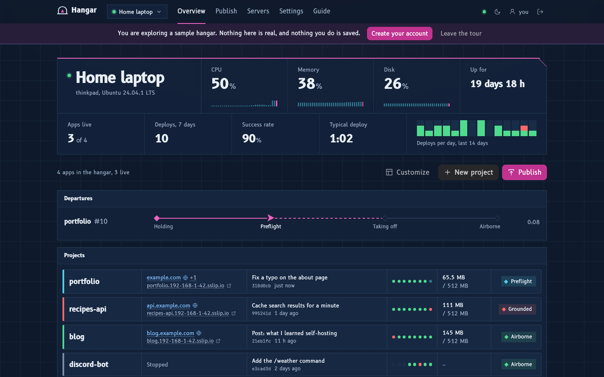

<div align="center">

# Hangar

**Deploy from GitHub to a computer you own.**

Hangar turns a spare laptop, mini PC, or Raspberry Pi into your own deploy platform. Connect a
GitHub repository and every push builds and goes live on your own domain, with logs, rollbacks,
and a dashboard called the Control Tower. Your code builds and runs at home, not on someone
else's cloud.

[](https://github.com/bduffaut/Hangar/actions/workflows/ci.yml)
[](https://github.com/bduffaut/Hangar/releases/latest)
[](LICENSE)

[**Try it at hangar.benduffaut.com**](https://hangar.benduffaut.com) ·
[Take the tour, no account needed](https://hangar.benduffaut.com/tour) ·
[Run it yourself](#run-hangar-yourself)



</div>

## What you get

- **Push to deploy.** Builds any repository with a Dockerfile, or detects the framework with
  [Railpack](https://railpack.com) (Node.js, Vite, Next.js, Astro, Python, Go, static sites and
  more).
- **Zero-downtime deploys.** Traffic moves to the new version only after it answers; a failed
  build leaves the running version alone.
- **One-click rollback** to any earlier version, without rebuilding.
- **Your own domains, no open ports.** Public addresses go through a free Cloudflare Tunnel, with
  HTTPS. Your home IP stays private.
- **Live everything.** Build logs as they happen, your app's own output, CPU and memory per app,
  and whether each address really answers from the internet.
- **Many servers, one dashboard.** Connect several machines and switch between them.
- **Accounts.** Each person sees only their own servers and apps.


## Two ways to use it

### 1. Use the hosted Control Tower (quickest)

1. Go to [hangar.benduffaut.com](https://hangar.benduffaut.com) and **sign up with GitHub**.
   Hangar only sees the repositories you choose, read-only.
2. **Connect your server.** Copy the one-line command it gives you and run it on your machine.
   It installs Hangar there and connects back. No ports to open.
3. **Put it on the internet.** Paste a free Cloudflare Tunnel token and add your domain.
4. **Publish a repository.** Pick one and press Publish.

The hosted site holds your sign-in, your list of servers, and your GitHub connection. Your code,
builds, apps, logs, and environment variables stay on your server, and your apps keep running if
the hosted site goes down. Because the hosted site can send your server requests, a connected
server trusts it; read [SECURITY.md](SECURITY.md#using-a-hosted-hangar-such-as-hangarbenduffautcom)
for exactly what that means. If you would rather not, run the whole thing yourself.

### 2. Run Hangar yourself

Everything, including the dashboard, runs on your own machine.

**You need** Ubuntu 22.04 or 24.04, or Debian 12, on amd64 or arm64, with 2 GB of memory and
10 GB of free disk. Docker is installed for you.

Download `hangar-installer.tar.gz` and its `.sha256` file from the
[latest release](https://github.com/bduffaut/Hangar/releases/latest), then on the server:

```sh
sha256sum -c hangar-installer.tar.gz.sha256
tar -xzf hangar-installer.tar.gz
sudo HANGAR_VERSION=0.3.0 bash installer/install.sh
```

The installer prints the Control Tower's address and a one-time setup code (the boarding pass).
Open the address, enter the code, and the Preflight Checklist walks you through the rest. By
default Hangar listens on every network the server is on; set `HANGAR_BIND_IP` to limit it to
one, such as a Tailscale address.

| To                   | Run                                                                   |
| -------------------- | --------------------------------------------------------------------- |
| Update               | `sudo hangar-update`                                                  |
| Remove               | `sudo hangar-uninstall`                                               |
| Get a new setup code | `sudo hangar-admin issue-setup-code`                                  |
| Reset a password     | `sudo hangar-admin reset-password <username>`                         |
| Let others sign up   | In the dashboard: **People → Sign in with GitHub**, then open sign-up |

## How it works

```
 Your browser ──▶ Control Tower (hosted, or on your server)
                        │  outbound connection from your server, no open ports
                        ▼
                  Your server: Hangar core ─▶ Docker ─▶ your apps
                        │
 Visitors ──▶ Cloudflare ──▶ tunnel on your server ──▶ your apps
```

Hangar is a TypeScript monorepo: a Fastify API and worker, a Vue 3 dashboard, Postgres (data,
job queue, and live events), Traefik for routing, and BuildKit for builds, all in Docker.

- [How Hangar works, in plain language](docs/GUIDE.md)
- [Architecture and decisions](docs/ARCHITECTURE.md)
- [Security model and known limits](SECURITY.md)
- [Changelog](CHANGELOG.md)

## Development

You need Node.js 24, pnpm 10, and Docker.

```sh
pnpm install
pnpm dev               # the stack, with the dashboard on http://localhost:5173
pnpm test              # unit tests
pnpm test:integration  # needs `pnpm dev` running
pnpm test:e2e          # browser tests
```

Open `http://localhost:5173/tour` to see the dashboard with sample data and no account. See
[CONTRIBUTING.md](CONTRIBUTING.md) before opening a pull request.

## License

MIT. See [LICENSE](LICENSE).
