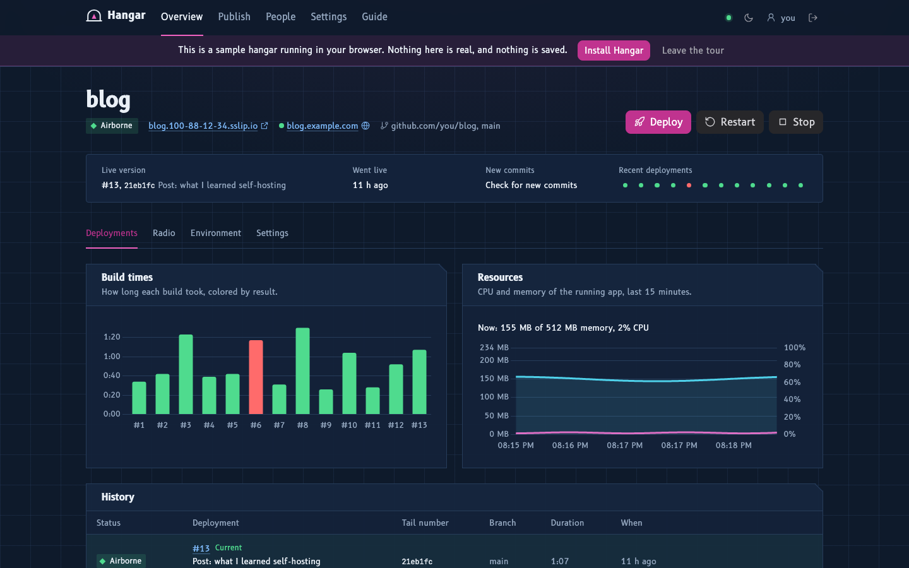

<div align="center">

# Hangar

**Deploy from GitHub to a computer you own.**

Hangar turns a spare laptop, mini PC, or Raspberry Pi into your own deploy platform. Connect a
GitHub repository and every push builds and goes live on your own domain, with logs, rollbacks,
and a dashboard called the Control Tower. Your code builds and runs at home, not on someone
else's cloud.

[](https://github.com/bduffaut/Hangar/actions/workflows/ci.yml)
[](https://github.com/bduffaut/Hangar/releases/latest)
[](LICENSE)

[**hangar.benduffaut.com**](https://hangar.benduffaut.com) ·
[Take the tour](https://hangar.benduffaut.com/tour) ·
[Install guide](https://hangar.benduffaut.com/docs/install)


</div>

## What you get

- **Push to deploy.** Builds any repository with a Dockerfile, or detects the framework with
  [Railpack](https://railpack.com) (Node.js, Vite, Next.js, Astro, Python, Go, static sites and
  more).
- **Zero-downtime deploys.** Traffic moves to the new version only after it answers; a failed
  build leaves the running version alone.
- **One-click rollback** to any earlier version, without rebuilding.
- **A private dashboard.** The Control Tower answers only on your
  [Tailscale](https://tailscale.com) network, at an address like `https://hangar.tail1234.ts.net`:
  reachable from all your devices, anywhere, and from nobody else's.
- **Your own domains, no open ports.** Apps you publish go through a free Cloudflare Tunnel, with
  HTTPS. Your home IP stays private.
- **Live everything.** Build logs as they happen, your app's own output, CPU and memory per app,
  and whether each address really answers from the internet.
- **Share it.** Invite family or a team; each person sees only their own apps.



## Install

On a spare computer with Ubuntu 22.04, 24.04 or 26.04, or Debian 12 or 13 (64-bit, 2 GB of memory,
10 GB of free disk):

```sh
curl -fsSL https://github.com/bduffaut/Hangar/releases/latest/download/install.sh | sudo bash
```

It installs Docker and Tailscale, asks you to sign the computer in to your Tailscale account, and
prints your private Control Tower address and a one-time setup code. Open the address on any device
with Tailscale, enter the code, and the Preflight Checklist walks you through the rest. The
[install guide](https://hangar.benduffaut.com/docs/install) has every step, for every level.

The script downloads the matching [GitHub release](https://github.com/bduffaut/Hangar/releases)
and checks its checksum before running it. To install by hand instead, download
`hangar-installer.tar.gz` and its `.sha256` from a release, then:

```sh
sha256sum -c hangar-installer.tar.gz.sha256
tar -xzf hangar-installer.tar.gz
sudo HANGAR_VERSION=0.3.1 bash installer/install.sh
```

| To                     | Run                                           |
| ---------------------- | --------------------------------------------- |
| Check everything       | `sudo hangar-doctor`                          |
| Update                 | `sudo hangar-update`                          |
| Set up Tailscale again | `sudo hangar-tailscale`                       |
| Get a new setup code   | `sudo hangar-admin issue-setup-code`          |
| Reset a password       | `sudo hangar-admin reset-password <username>` |
| Remove                 | `sudo hangar-uninstall`                       |

## How it works

```
 Your phone / laptop ──Tailscale──▶ Control Tower ┐
                                                  │
 GitHub ◀── new commits? ── Hangar ─▶ Docker ─▶ your apps   all on your computer
                                                  │
 Visitors ──▶ Cloudflare ──▶ tunnel ────────▶ your apps ┘
```

Everything runs on your computer. [hangar.benduffaut.com](https://hangar.benduffaut.com) is only
the guide, the tour, and the install script: it has no accounts and never talks to your Hangar.

Hangar is a TypeScript monorepo: a Fastify API and worker, a Vue 3 dashboard, Postgres (data,
job queue, and live events), Traefik for routing, and BuildKit for builds, all in Docker.

- [Guides: install, Tailscale, going public, GitHub, sharing, troubleshooting](docs/guides)
- [How the code works, in plain language](docs/GUIDE.md)
- [Architecture and decisions](docs/ARCHITECTURE.md)
- [Security model and known limits](SECURITY.md)
- [Changelog](CHANGELOG.md)

## Development

You need Node.js 24, pnpm 10, and Docker.

```sh
pnpm install
pnpm dev               # the stack, with the dashboard on http://localhost:5173
pnpm test              # unit tests
pnpm test:integration  # needs `pnpm dev` running
pnpm test:e2e          # browser tests
pnpm site              # the public site (front page, guides, tour) on http://localhost:5174
pnpm test:site         # its browser tests
```

See
[CONTRIBUTING.md](CONTRIBUTING.md) before opening a pull request.

## License

MIT. See [LICENSE](LICENSE).
