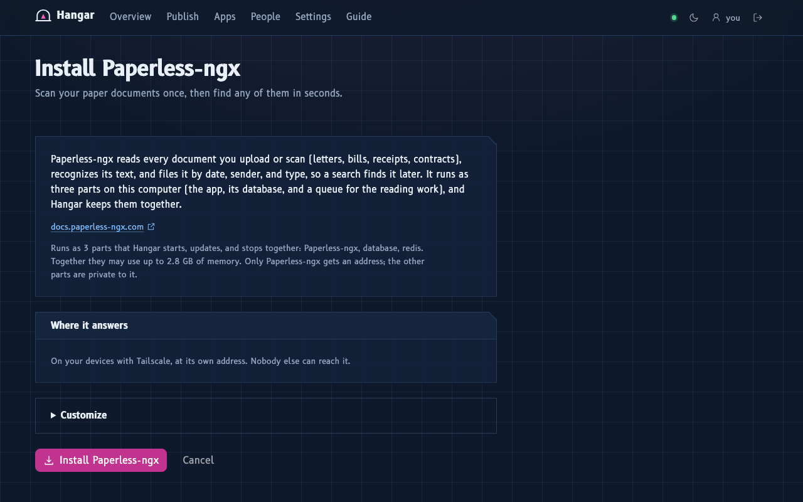

# Documents and files

Three apps keep paper and files on the Hangar computer:

- **Paperless-ngx** reads every letter, bill, and receipt you give it, recognizes the text, and
  files it so a search finds it later.
- **File Browser** is a simple web page for keeping files: upload from your phone, organize
  folders, and share a link to a file.
- **Syncthing** keeps folders identical across your computers and phone, with this computer as
  the copy that is always on.

Every account can install Paperless-ngx and File Browser. Syncthing syncs through a port of the
computer, so an admin installs it.

## Paperless-ngx

### 1. Install it

Open **Apps**, pick **Paperless-ngx**, and press **Install Paperless-ngx**.

Paperless-ngx runs as three parts: the app, its database, and a queue for the reading work. Hangar
starts, updates, and stops them together and makes the database password for you.

### 2. Create your account

Open the app's address on a device with Tailscale and create your account. The first account has
full access, so do this right after installing.

### 3. Add documents

- **Drag files** (PDFs, photos of a page, office documents) onto the Paperless page.
- **Scan with your phone**: a Paperless phone app (such as Paperless Mobile or Swift Paperless)
  takes a picture and uploads it. Sign in with the app's address and your account.

Paperless reads each document in the background; a page takes a few seconds. Then search for any
word on it, and add tags, correspondents, and document types to sort them.

### Where documents are kept

| Kept folder                       | Holds                                             |
| --------------------------------- | ------------------------------------------------- |
| `media`                           | Your documents: the originals and searchable PDFs |
| `data`                            | The search index, settings, and accounts          |
| `database` (of the database part) | Tags, correspondents, and where each document is  |
| `queue` (of the redis part)       | Documents waiting to be read                      |

### On the internet

Paperless only accepts sign-ins from addresses it knows. When you give it a public address under
**Settings → Public addresses**, Hangar tells Paperless about it and restarts it, so signing in
from there works with nothing else to set.

## File Browser

### 1. Install it

Open **Apps**, pick **File Browser**, and press **Install File Browser**.

### 2. Sign in

File Browser makes a random password for its `admin` account when it first starts:

1. Open the app's **Logs** tab in Hangar.
2. Find the line that starts `User 'admin' initialized` and copy the password from it.
3. Open the app, sign in as `admin` with that password, and change it under **Settings →
   Profile**.

### 3. Use it

Drag files onto the page to upload them, make folders, and use **Share** to make a link to a
file. Files are kept in the app's `files` storage, which survives updates. Accounts and shared
links are in `database`.

> **Sharing a link with someone outside your devices** needs a public address for File Browser
> (see [Put your apps on the internet](go-public.md)). Without one, a share link only opens on
> devices with Tailscale.

## Syncthing

Syncthing keeps folders in sync between your devices. With the Hangar computer always on, your
laptop and phone stay in sync even when they are never on at the same time.

1. Open **Apps**, pick **Syncthing**, and install it. It syncs on port 22000 of the computer's
   Tailscale address, so only your devices with Tailscale can sync with it.
2. Open it and set a user name and password under **Settings → GUI** right away.
3. Install Syncthing on your other devices (Syncthing for Android, or Möbius Sync on iPhone).
   Add the Hangar computer with its device ID (**Actions → Show ID**), and give its address as
   `tcp://<computer's Tailscale name>:22000`.
4. Share a folder from either side and accept it on the other.

Synced folders live in the app's `data` storage, under `/var/syncthing`.
