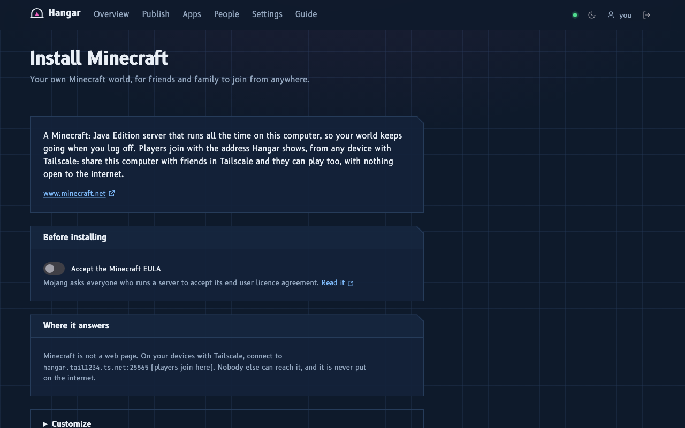
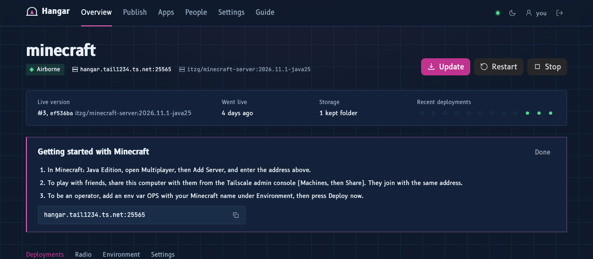

# Game servers

**Minecraft** runs on the Hangar computer all the time, so your world keeps going when you log off,
and everyone you invite joins from their own computer. Like every app, it is private: players
reach it over Tailscale, and nothing is opened on your home network or the internet.

Minecraft uses a port on the computer (25565), so an admin installs it.

## 1. Install Minecraft

1. In the dashboard, open **Apps** and pick **Minecraft**.
2. Read Minecraft's EULA and turn on **Accept the Minecraft EULA**. Mojang asks everyone who runs
   a server to accept it, so Hangar does not do it for you.
3. Press **Install Minecraft**.

The first start downloads the server and makes a new world, which takes a minute or two. The
app's page then shows the address to join, like `hangar.tail1234.ts.net:25565`, with a button to
copy it. The launcher tile on the home screen copies it too.

## 2. Join

In **Minecraft: Java Edition**, open **Multiplayer**, then **Add Server**, and paste the address.
Your computer needs Tailscale on, like any device that reaches Hangar.

This is the Java Edition. Bedrock players (phones, consoles, Windows' Bedrock edition) cannot join a
Java server.

## 3. Invite friends

Friends join through your Tailscale network, without an account on Hangar:

1. In the [Tailscale admin console](https://login.tailscale.com/admin/machines), open the Hangar
   computer's menu and choose **Share**. Send the invite link to your friend.
2. Your friend installs Tailscale, signs in with their own account, and accepts the invite. They
   see only the Hangar computer, not your other devices.
3. They join with the same address. If the name does not work for them, use the computer's
   Tailscale address (`100.x.y.z`, shown in the admin console) with `:25565`.

## Settings

The server reads its settings from env vars, under the app's **Environment** tab. Change one, then
press **Deploy now** so the server starts again with it. Some useful ones:

| Env var      | What it does                                                                | Example     |
| ------------ | --------------------------------------------------------------------------- | ----------- |
| `OPS`        | Players who are operators (can use admin commands)                          | `alex,sam`  |
| `MOTD`       | The line players see in the server list                                     | `Our world` |
| `DIFFICULTY` | `peaceful`, `easy`, `normal`, or `hard`                                     | `normal`    |
| `MODE`       | The game mode for new players                                               | `survival`  |
| `WHITELIST`  | Only these players may join                                                 | `alex,sam`  |
| `MEMORY`     | How much memory the game itself uses (keep it below the app's memory limit) | `2G`        |

The full list is in the server image's
[documentation](https://docker-minecraft-server.readthedocs.io/en/latest/variables/).

## Good to know

- **The world is kept** in the app's `data` storage, with the players and the server's settings.
  It survives restarts, updates, and Hangar's own updates.
- **The game version is pinned** (`VERSION`, 26.3 at install). A world opened by a newer version
  cannot go back to an older one, so change `VERSION` deliberately.
- **Memory.** The app may use up to 3 GB. Raise the limit under **Settings** if many players join
  or you add a large world, and raise `MEMORY` with it.
- **Only one Minecraft server** can use port 25565 on the computer at a time.
