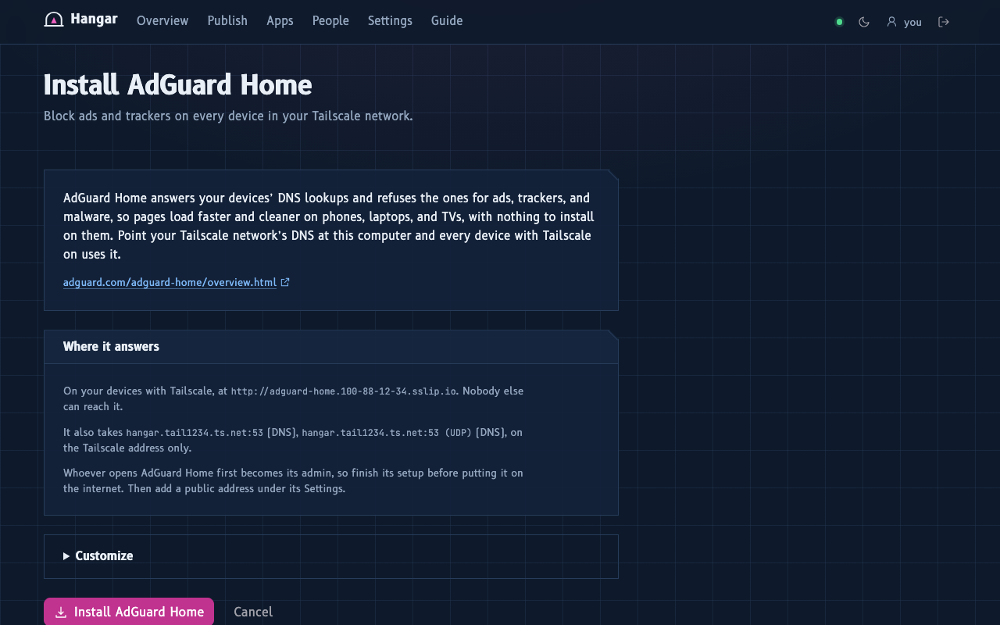

# Around the house

Small apps for the household:

- **Mealie** saves recipes from any website, plans the week's meals, and makes the shopping list.
- **Uptime Kuma** checks your sites and apps every minute and tells you when one goes down.
- **AdGuard Home** blocks ads and trackers on every device in your Tailscale network.
- **ntfy** sends notifications to your phone from scripts, apps, and other servers.
- **Actual Budget** keeps a household budget, synced between your devices.

Every account can install Mealie, Uptime Kuma, ntfy, and Actual Budget. AdGuard Home answers DNS on a port of the
computer, so an admin installs it.

## Mealie

### 1. Install it

Open **Apps**, pick **Mealie**, and press **Install Mealie**.


### 2. Sign in and change the password

Mealie starts with a shared default account. Change it before anything else:

1. Open the app and sign in with `changeme@example.com` and the password `MyPassword`.
2. Follow its setup, then change that email and password under your profile.

### 3. Add recipes

Paste a link to any recipe page and Mealie saves the ingredients, steps, and photo, without the
ads. From there, scale a recipe, plan meals for the week, and turn the plan into a shopping list.
Everyone in the household can have their own account; invite them from Mealie's settings.

Recipes, photos, and accounts are kept in the app's `data` storage, which survives updates.

## Uptime Kuma

### 1. Install it

Open **Apps**, pick **Uptime Kuma**, and press **Install Uptime Kuma**.

### 2. Set it up

1. Open the app. When it asks for a database, choose **SQLite**: it needs nothing else.
2. Create your admin account.

### 3. Watch something

1. **Add New Monitor**: pick **HTTP(s)**, name it, and paste a site's address. Uptime Kuma checks
   it every minute and keeps a history of when it was up.
2. **Settings → Notifications**: add a way to hear about it, such as email, Discord, Telegram,
   or ntfy, then turn it on for your monitors.

Uptime Kuma can also show a public **status page**. It needs a public address for the app (see
[Put your apps on the internet](go-public.md)); the rest of Uptime Kuma stays behind its sign-in.

Monitors, history, and settings are kept in the app's `data` storage.

## AdGuard Home

AdGuard Home answers your devices' DNS lookups (turning `example.com` into an address) and
refuses the ones for ads, trackers, and malware. Every device with Tailscale on uses it once your
tailnet points its DNS at it, with nothing to install on the device.

### 1. Install it

Open **Apps**, pick **AdGuard Home**, and press **Install AdGuard Home**. It answers DNS on port
53 of the computer's Tailscale address, so nothing on your home network or the internet can use
it.



### 2. Set it up

Open the app's address and follow its setup:

1. Under **Admin Web Interface**, set the port to **3000**, not 80. Hangar reaches the app on
   3000, so another port makes its address stop working.
2. Keep **DNS server** on port 53.
3. Create your account.

### 3. Point your tailnet at it

1. In the [Tailscale admin console](https://login.tailscale.com/admin/dns), open **DNS**.
2. Under **Nameservers**, add a custom nameserver: the Hangar computer's Tailscale address
   (`100.x.y.z`, shown on its line under **Machines**).
3. Turn on **Override DNS servers**.

Browse on any device with Tailscale on, then open AdGuard Home's **Query Log**: each lookup is
there, and blocked ones are in red. Add more block lists under **Filters**.

> **When the Hangar computer is off,** devices using it for DNS cannot look anything up while
> Tailscale is on. Add a second nameserver (such as `1.1.1.1`) after it in Tailscale's DNS page
> if you want a fallback, knowing lookups that go there are not filtered.

## ntfy

ntfy pushes notifications to your phone. Anything that can send a web request can use it: a
backup script, Uptime Kuma, Home Assistant.

1. Open **Apps**, pick **ntfy**, and install it.
2. Install the ntfy app on your phone. In its settings, set the **default server** to the app's
   address, then subscribe to a topic with a hard-to-guess name, like `home-7f3k2`.
3. From any computer with Tailscale, send a test to the address shown on the app's page:

   ```sh
   curl -d "Backup finished" <ntfy's address>/home-7f3k2
   ```

Anyone who can reach ntfy can read and post to any topic. Over Tailscale that is only your
devices; before giving it a public address, set up its
[access control](https://docs.ntfy.sh/config/#access-control).

## Actual Budget

1. Open **Apps**, pick **Actual Budget**, and install it.
2. Open it and set the **server password** right away: anyone who knows it can open your budgets.
3. Create a budget, or import one from YNAB or a file from your bank.

On your phone, open the app's address in the browser and add it to the home screen. Your budgets
are kept in the app's `data` storage.
