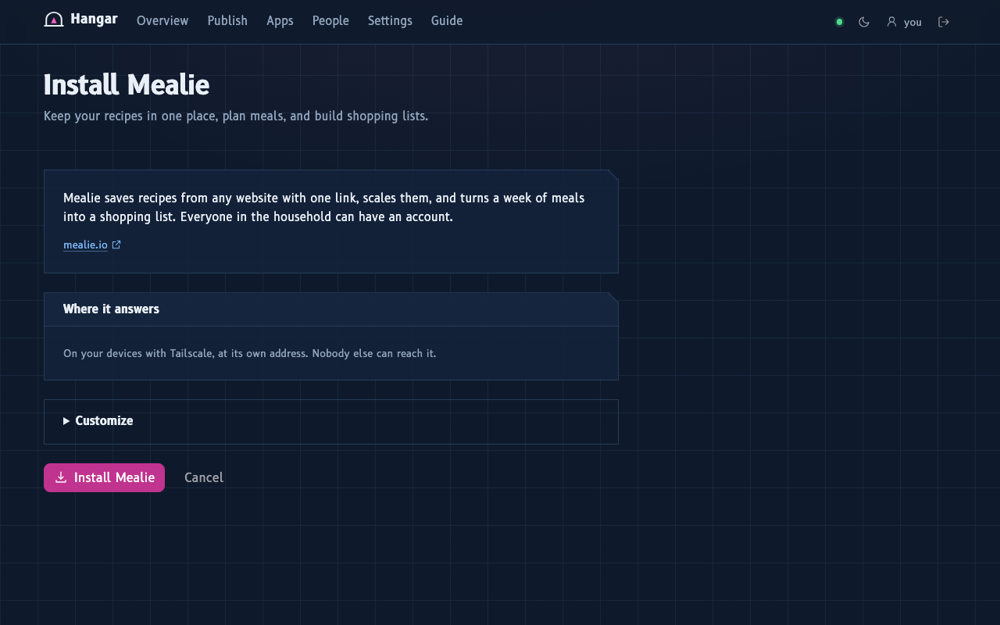

# Recipes and monitoring

Two small apps for the household, and every account can install both:

- **Mealie** saves recipes from any website, plans the week's meals, and makes the shopping list.
- **Uptime Kuma** checks your sites and apps every minute and tells you when one goes down.

## Mealie

### 1. Install it

Open **Apps**, pick **Mealie**, and press **Install Mealie**.

### 2. Sign in and change the password

Mealie starts with a shared default account. Change it before anything else:

1. Open the app and sign in with `changeme@example.com` and the password `MyPassword`.
2. Follow its setup, then change that email and password under your profile.

### 3. Add recipes

Paste a link to any recipe page and Mealie saves the ingredients, steps, and photo, without the
ads. From there, scale a recipe, plan meals for the week, and turn the plan into a shopping list.
Everyone in the household can have their own account; invite them from Mealie's settings.

Recipes, photos, and accounts are kept in the app's `data` storage, which survives updates.

## Uptime Kuma

### 1. Install it

Open **Apps**, pick **Uptime Kuma**, and press **Install Uptime Kuma**.

### 2. Set it up

1. Open the app. When it asks for a database, choose **SQLite**: it needs nothing else.
2. Create your admin account.

### 3. Watch something

1. **Add New Monitor**: pick **HTTP(s)**, name it, and paste a site's address. Uptime Kuma checks
   it every minute and keeps a history of when it was up.
2. **Settings → Notifications**: add a way to hear about it, such as email, Discord, Telegram,
   or ntfy, then turn it on for your monitors.

Uptime Kuma can also show a public **status page**. It needs a public address for the app (see
[Put your apps on the internet](go-public.md)); the rest of Uptime Kuma stays behind its sign-in.

Monitors, history, and settings are kept in the app's `data` storage.
