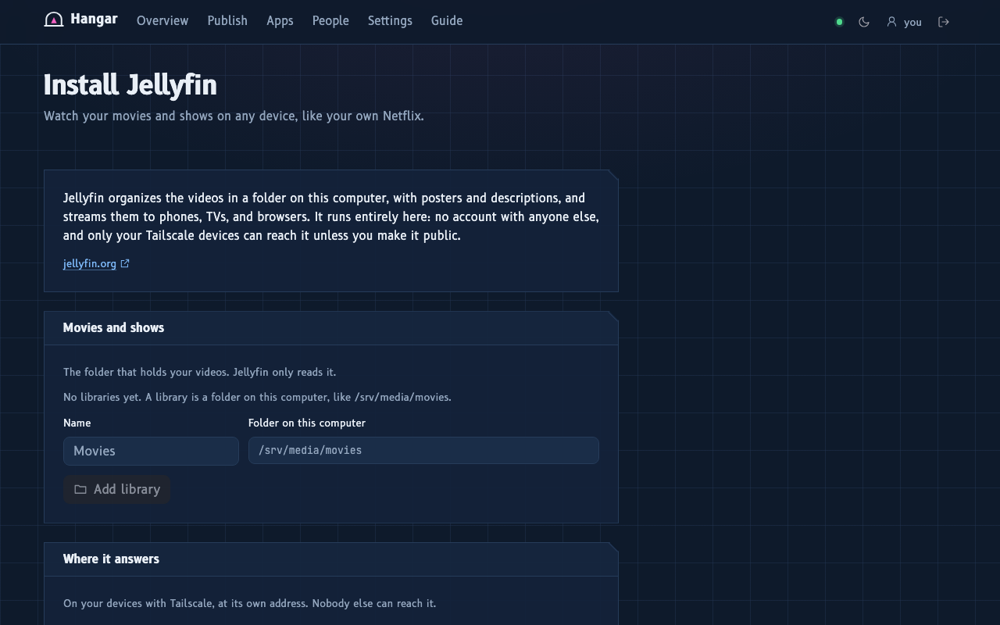

# Movies, music, and books

Jellyfin, Navidrome, and Audiobookshelf play files you already have: videos, music, or
audiobooks in a folder on the Hangar computer. Hangar shares that folder with the app as a
**library**, read-only, so the app can never change or delete your files. Libraries reach outside
an app's own storage, so installing these apps needs an admin.

| App                | Plays                   | Folder inside the app | Phone apps                               |
| ------------------ | ----------------------- | --------------------- | ---------------------------------------- |
| **Jellyfin**       | Movies and shows        | `/media`              | Jellyfin, for phones and TVs             |
| **Navidrome**      | Music                   | `/music`              | Any Subsonic app (Substreamer, play:Sub) |
| **Audiobookshelf** | Audiobooks and podcasts | `/audiobooks`         | Audiobookshelf, with offline listening   |

## 1. Put your files in a folder

Copy your videos to a folder on the Hangar computer, for example `/srv/media/movies`:

```sh
sudo mkdir -p /srv/media/movies
```

Then copy files in over the network, from a USB drive, or with `scp` from your laptop:

```sh
scp -r ~/Movies/* you@computer:/srv/media/movies/
```

An external drive works too. It usually appears under `/media/<you>/<drive name>` or `/mnt`.
Music and audiobooks work the same way, in their own folders (`/srv/media/music`,
`/srv/media/audiobooks`).

## 2. Install Jellyfin

1. In the dashboard, open **Apps** and pick **Jellyfin**.
2. Under **Movies and shows**, add your folder as a **library**: give it a name (Movies) and its
   path (`/srv/media/movies`). Hangar checks that the folder exists.
3. If the computer has a graphics chip, leave **Graphics chip** on. Video then plays smoothly on
   phones and TVs.
4. Press **Install Jellyfin**.



Hangar downloads Jellyfin (about a minute the first time) and starts it. The app's page shows its
address and the first steps.

## 3. Set Jellyfin up

Open the address on any device with Tailscale and follow Jellyfin's own setup:

1. Pick a language and create your Jellyfin account.
2. Add a media library: choose **Movies** (or **Shows**) and the folder **`/media`**. That is where
   Hangar puts your library inside the app.
3. Install the Jellyfin app on your phone or TV, and sign in with the same address.

Jellyfin keeps its settings, accounts, and watch history in its own storage (`config`), and
thumbnails and converted video in `cache`. Both survive updates.

## Navidrome

1. Open **Apps**, pick **Navidrome**, and add your music folder under **Music**.
2. Install it, open it, and create the admin account.
3. Navidrome finds the music by itself; a large collection takes a few minutes the first time.
4. On your phone, install a Subsonic app (such as Substreamer or play:Sub) and sign in with the
   app's address and your Navidrome account.

Navidrome is light: it fits in half a gigabyte of memory, even with a very large collection.

## Audiobookshelf

1. Open **Apps**, pick **Audiobookshelf**, and add your audiobooks folder under **Audiobooks**.
2. Install it, open it, and create the root account.
3. Add a library in Audiobookshelf and choose the folder **`/audiobooks`**.
4. Install the Audiobookshelf app on your phone and sign in with the app's address. It remembers
   where each listener stopped, and can download books for listening offline.

Audiobookshelf can also follow podcasts and download new episodes. They go to its own storage,
since the library is read-only to it.

## Good to know

- **Adding files later** needs nothing in Hangar: copy them into the folder and the app finds
  them. Each app scans on its own schedule, and has a scan button in its settings to do it now.
- **More than one folder?** Add a library per folder when installing, or later under the app's
  **Settings → Storage**. An admin can also add one to an app that is already installed.
- **Letting an app write to a library** (for example so Jellyfin saves posters next to your
  videos) is a switch under **Settings → Storage**. Leave it off unless the app needs it.
- **Away from home?** Turn Tailscale on on your phone and the same address works anywhere. A
  public address is possible but rarely needed for these apps.
