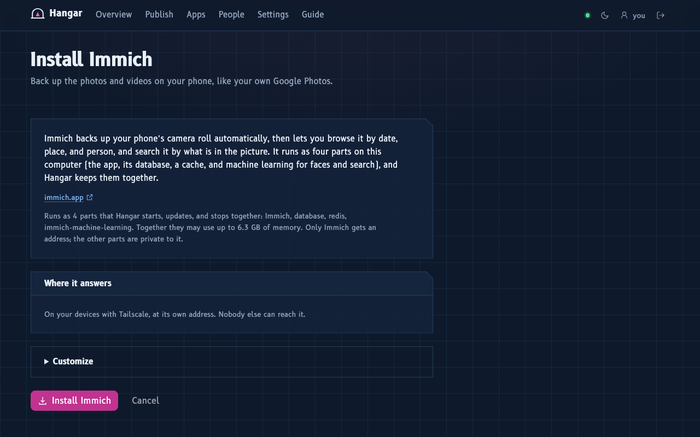

# Photos

**Immich** backs up your phone's camera roll to the Hangar computer, then lets you browse it by
date, place, and person, and search it by what is in the picture ("dog on a beach"). It works like
your own Google Photos or iCloud Photos, with the photos kept at home. Every account can install
it.

## 1. Install Immich

1. In the dashboard, open **Apps** and pick **Immich**.
2. Press **Install Immich**.

The first install downloads several gigabytes (the app, its database, and machine learning), so
it can take a while on a slow connection. The deployment page shows how far it got.

## 2. Create your account

Open the app's address on a device with Tailscale and create the admin account. The first
account to sign up becomes the admin, which is why Hangar keeps Immich private while you do this.

## 3. Back up your phone

1. Install the Immich app on your phone (App Store or Google Play).
2. Turn Tailscale on on the phone.
3. In the Immich app, enter the app's address, sign in, and turn on **Backup**.

The phone uploads its camera roll in the background, and from then on every new photo. Faces and
search start working after the first photos arrive: the models download once, which takes a few
minutes.

Each person in the house can have their own Immich account; share albums between them inside
Immich.

## How Immich runs

Immich is four parts: the app, a database for albums and people, a cache, and machine learning
for faces and search. Hangar starts, updates, and stops them together, makes the database password
for you, and keeps the database where only Immich can reach it. The app's **Radio** tab shows how
each part is doing. Together the parts may use up to about 6 GB of memory; on a computer with
8 GB, Immich is best as the biggest app it runs.

| Kept folder                       | Holds                                   |
| --------------------------------- | --------------------------------------- |
| `library`                         | Your photos and videos                  |
| `database` (of the database part) | Albums, people, and where each photo is |
| `model-cache` (machine learning)  | Face and search models, downloaded once |

All of them survive updates and Hangar's own updates. They are listed with their size under the
app's **Settings → Storage**.

## Updating

Immich releases often. When a new version is out, the app's page offers it in one click (see
[New versions](apps.md#new-versions)). Immich changes its database when it updates and cannot
go back afterwards, so read its release notes before a big jump, and keep the phone app on a
matching version.

## Good to know

- **Away from home**, the phone keeps backing up whenever Tailscale is on. A public address is
  possible, but your photos are safest kept private.
- **Room to grow.** Photos and videos fill a disk fast. **Settings → Storage** shows how much the
  `library` folder takes.
- **Already have photos on the computer?** Immich's own command-line tool can import a folder;
  see its documentation at [immich.app](https://immich.app).
