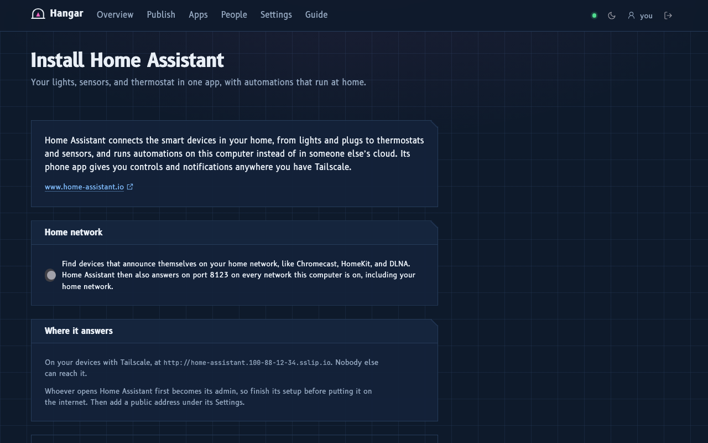

# Smart home

**Home Assistant** brings your lights, sensors, plugs, and thermostats into one app, with
automations that run at home instead of in someone else's cloud. **Mosquitto** is the message
broker many smart home devices and apps talk through (MQTT). Every account can install both.

## Home Assistant

### 1. Install it

Open **Apps**, pick **Home Assistant**, and press **Install Home Assistant**. The first download
is large (over a gigabyte), so it can take a few minutes.

Hangar gives Home Assistant a starting `configuration.yaml` that trusts Hangar's proxy, so it
works at its private address straight away. Hangar writes it only when there is none, so your own
edits are never overwritten.

### 2. Set it up

Open the app's address on a device with Tailscale. The first person to open it creates the owner
account, so do this right after installing. Home Assistant then asks for your home's location,
time zone, and units, and lists the devices it found.

### 3. Add your devices

Under **Settings → Devices & services**, add an integration for each kind of device: Philips Hue,
Shelly, a TP-Link plug, your thermostat. Most ask for the device's address on your home network.

Install the **Home Assistant** app on your phone and sign in with the app's address to get
controls, notifications, and your phone's location for automations. Your phone needs Tailscale
on, at home and away.

### Finding devices on your home network

By default Home Assistant runs like every app in Hangar: on its own private network, reachable
over Tailscale. Devices it talks to by address or through a cloud account work as usual.

Devices that announce themselves on the home network (Chromecast, HomeKit, DLNA, many smart TVs)
are only found when Home Assistant is on the computer's own network. An admin can turn that on
while installing, under **Home network**. Then:

- Home Assistant also answers at the computer's home network address, port 8123, to anyone on
  that network. Its private address over Tailscale stays the same.
- It cannot reach Mosquitto by name, since Mosquitto stays on Hangar's private network. Use
  Mosquitto only with Home Assistant on its default network for now.
- If its address stops answering after you turn this on, the computer's firewall may block
  Docker's networks from reaching it: allow traffic from `172.16.0.0/12` to port 8123.

**USB sticks** (Zigbee, Z-Wave) need Hangar to pass the stick to the app, which is coming next.

Its settings, automations, and history are kept in the app's `config` storage, which survives
updates.

## Mosquitto

Mosquitto has no web page and no address of its own. Other apps of your account reach it by its
name, `mosquitto`, on port 1883:

1. Open **Apps**, pick **Mosquitto**, and press **Install Mosquitto**. Keep the name `mosquitto`.
2. In Home Assistant, add the **MQTT** integration with the broker `mosquitto` and port `1883`.
   Leave the user name and password empty.

Only apps of the same account can reach it: nothing on your home network, your Tailscale devices,
or the internet. Its settings are in `config/mosquitto.conf` and its saved messages in `data`.
