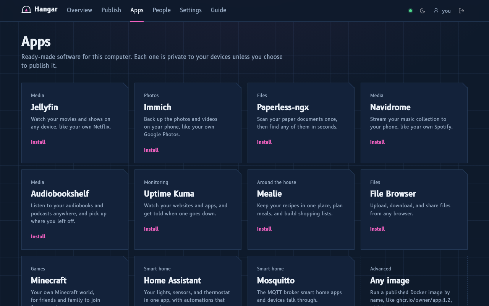
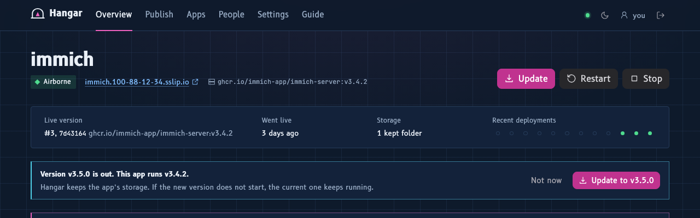
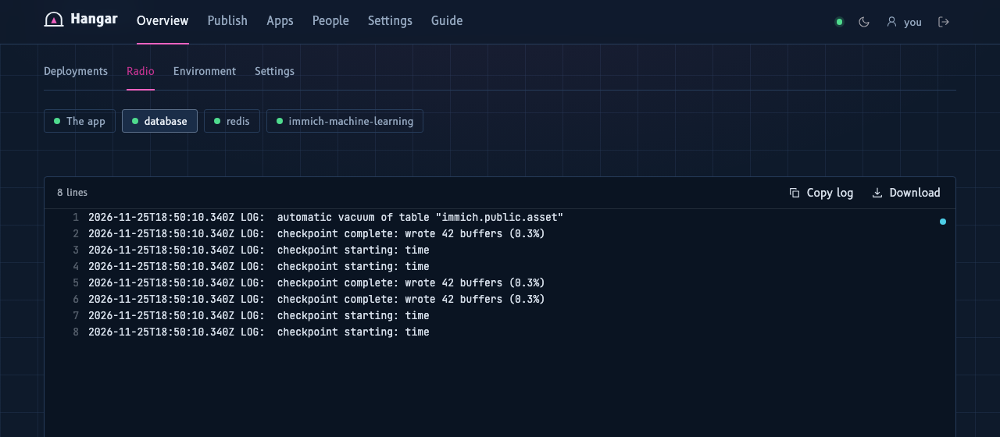

# Install apps

Besides your own code, Hangar runs ready-made apps: software someone else publishes as a Docker
image. Open **Apps** in the dashboard, pick one, and press **Install**. Every app works with the
choices already filled in.

| App                | What it does                                               | Guide                                     | Who can install it |
| ------------------ | ---------------------------------------------------------- | ----------------------------------------- | ------------------ |
| **Jellyfin**       | Movies and shows on any device, like your own Netflix      | [Movies, music, and books](apps-media.md) | Admins             |
| **Navidrome**      | Your music collection, like your own Spotify               | [Movies, music, and books](apps-media.md) | Admins             |
| **Audiobookshelf** | Audiobooks and podcasts, with progress kept                | [Movies, music, and books](apps-media.md) | Admins             |
| **Immich**         | Backs up your phone's photos, like your own Google Photos  | [Photos](apps-photos.md)                  | Everyone           |
| **Paperless-ngx**  | Your paper documents, scanned, read, and searchable        | [Documents and files](apps-documents.md)  | Everyone           |
| **File Browser**   | Upload, download, and share files from a browser           | [Documents and files](apps-documents.md)  | Everyone           |
| **Mealie**         | Recipes, meal plans, and shopping lists                    | [Around the house](apps-home.md)          | Everyone           |
| **Uptime Kuma**    | Watches your sites and tells you when one is down          | [Around the house](apps-home.md)          | Everyone           |
| **AdGuard Home**   | Blocks ads and trackers on every device in your tailnet    | [Around the house](apps-home.md)          | Admins             |
| **Home Assistant** | Your lights, sensors, and thermostat in one app            | [Smart home](apps-smart-home.md)          | Everyone           |
| **Mosquitto**      | The MQTT broker smart home apps talk through               | [Smart home](apps-smart-home.md)          | Everyone           |
| **Zigbee2MQTT**    | Zigbee lights and sensors from any brand, with a USB stick | [Smart home](apps-smart-home.md)          | Admins             |
| **Minecraft**      | Your own world, for friends to join over Tailscale         | [Game servers](apps-games.md)             | Admins             |

More are on the [roadmap](https://github.com/bduffaut/Hangar/blob/main/docs/ROADMAP.md).

> **Who can install what.** Apps that read a folder on the computer (your movies, music, or
> books), use its graphics chip, or take one of its ports (a game server) need an admin. The
> others are open to every account. Hangar installs them exactly as the catalog describes,
> whatever the form sends.

## Private until you say so

A new app answers only on your devices with Tailscale, at its own address. The app's page shows
that address once it is running, along with its first steps, and the home screen gets a tile
that opens it.

> **Set an app up right after installing it.** Most apps make whoever opens them first their
> admin. That is why Hangar does not offer a public address while installing those apps: finish
> the setup on your own devices first, then add an address under the app's **Settings**.

## What Hangar keeps for you

- **Kept folders.** Each app's settings, accounts, and content live in storage that survives
  restarts, updates, and Hangar's own updates. Each app's **Settings → Storage** lists them, with
  their size.
- **Libraries are read-only** unless you allow writing in **Settings → Storage**.
- **Deleting an app keeps its data** unless you tick the box to delete it too. Install it again
  with the same name and it picks the data back up. Data left by deleted apps is listed under
  **Settings → Storage**.

## New versions

An app's version is pinned: it changes only when you say so. When a newer version is out, the
app's page says so:

Press **Update to v3.5.0** to switch. Hangar downloads it and stops the running version first, so
two copies never write to the same storage. If the new one does not start, it starts the previous
one again. Hangar checks at most twice a day, and only offers versions in the same style as the
one you run (so never `latest` or a test release). Some apps change their data when they update
and cannot go back to an older version afterwards; read the app's release notes before a big
jump.

You can also type a version under the app's **Settings**, then press **Update**. Anyone with an
account can change the version of an app they installed; only an admin can point an app at a
different image.

## Apps made of several parts

Immich and Paperless-ngx each run as several containers: the app plus its own database and
queue. Hangar starts, updates, and stops them together, makes their passwords for you, and keeps
the databases where only their app can reach them. The app's **Radio** tab lists the parts with
how each is doing; pick one to see its live output, for example when the database will not
start.

## Any other app

**Apps → Any image** (admins only) runs any published Docker image, such as
`ghcr.io/owner/app:1.2`:

1. Enter the image, with a version.
2. Under **Customize**, add a **kept folder** for each folder the image's documentation calls a
   volume (often `/config` or `/data`). Without one, the app starts fresh after every update.
3. Set the **web port** if the image listens on more than one.
4. For something that is not a web page, like a game server, turn on **Not a web page** and add
   its **ports**. They are published on the computer's Tailscale address only, at the same
   number, and Hangar checks the app by connecting to its port.

## On the internet

An app can also get a public address, like any project: turn on **Also put it on the internet**
when installing, or add an address under the app's **Settings → Public addresses**. See
[Put your apps on the internet](go-public.md). For a media server or your photos, staying private
is usually best: Tailscale already reaches them from anywhere.
